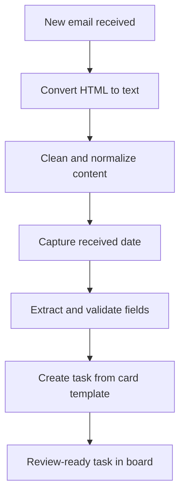

# Email-to-Task Automation | Power Automate

**Workflow automation case study** · Microsoft Power Automate · Outlook · Trello · Content Conversion

> **Portfolio reproduction:** This is an anonymized description of a workplace automation project. Examples and screenshots have been generalized or redacted. It is not a deployable copy of an employer's production workflow.

## The challenge

Operational teams receive structured requests by email, but entering their details into a task board manually introduces repetitive work and opportunities for inconsistent records. The incoming emails were HTML-based, and converting them into plain text sometimes merged fields or left invisible Unicode characters in the output.

## The solution

I built a rule-based Power Automate flow that responds to a new intake email, normalizes its contents, extracts selected values, and creates a standardized Trello task based on a preconfigured card layout.

## Screenshots

The following images were uploaded to this repository. Screenshots are provided for illustration and should be reviewed for confidentiality before making the repository public.

**Workflow overview**

**Workflow execution history**

**Sample task output**

**Expanded field extraction**

## My implementation

- Connected an Outlook email trigger to text conversion and task creation.
- Normalized problematic Unicode characters in converted emails before parsing them.
- Extracted individual fields using delimiter-based expressions and conditional checks for missing labels.
- Reused a reference card so generated tasks follow a consistent structure and include predefined task elements.
- Formatted the output as a readable task description, including a locally formatted receipt date.

## Challenges and decisions

| Challenge | Response |
| --- | --- |
| HTML table cells merge when converted to text | Bounded extraction using labels instead of relying on line breaks |
| Invisible Unicode breaks matches | Single normalization step before field extraction |
| Missing optional fields can break indexing expressions | Conditional checks before extraction |
| Formatting differs between email and task view | Explicit formatting of output fields |
| AI would add cost without clear benefit | Deterministic, rule-based workflow instead |

## Scope and evidence

The documented flow has **16 actions** in total: 6 at the main level and 10 inside the extraction scope. It uses **three connectors** and **no AI-model calls**. The supplied run history shows multiple successful executions.

The primary email-to-task path was implemented and tested. Additional status-specific routing and some optional-field edge cases were identified as follow-up improvements, not completed functionality.

**No productivity savings have been attributed exclusively to this flow** in this case study, as an independently verified project-specific baseline is not provided.

## Data and confidentiality

The written case study intentionally omits production configuration, original parsing expressions, and corporate contact details. Images must be separately reviewed for confidentiality before making the repository public.

## Author contribution

Workflow design, Power Automate implementation, troubleshooting, testing, documentation and iterative improvement.
